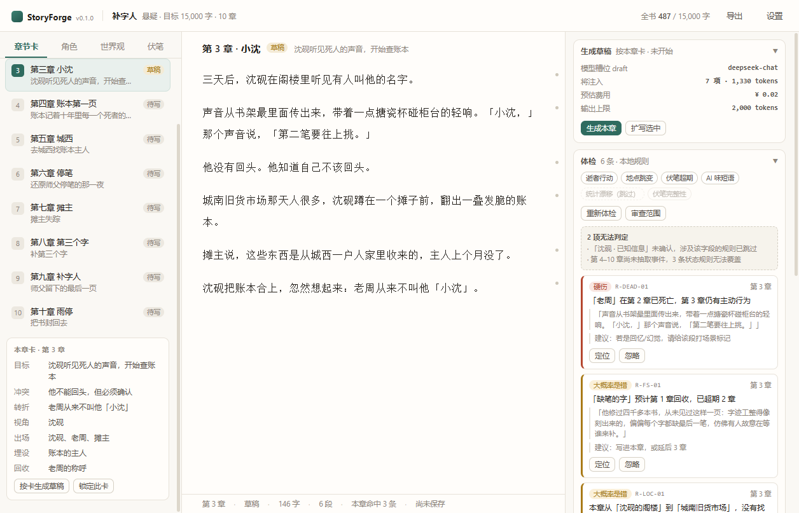

# StoryForge

> 本地优先、自带 API Key 的中文小说创作工作台。
> 它不替你写完一本书，它帮你**把卡住的那一章写完**：章节卡约束、设定账本记状态、规则引擎抓错、AI 只出建议，正文永远归你。

[](#测试)
[](#许可)
[](#怎么跑)



---

## 它到底做什么

| 你会遇到的麻烦 | StoryForge 的做法 |
| --- | --- |
| 只有一个脑洞，不知道怎么落地 | 向导把一句话拆成题材、卖点、核心阻力、10 张章节卡（可让模型先搭骨架，也可自己改） |
| 角色写着写着就崩（死人开口、地点瞬移、性格漂移） | 12 条本地规则 + 独立审阅模型，每条问题带**证据段落 + 引用原文 + 修改建议**，不直接改你的字 |
| 伏笔埋了就忘 | 伏笔账本：埋设章 / 预期回收章 / 状态，超期直接红 |
| 改一点就面目全非，想退回去 | 段落即 block，每次提交是一版；可看历史、可回滚；AI 改写走三路合并，逐句选 |
| 不知道像不像 AI 写的 | 文风卡（风格包 + 手改字段 + 投喂样本）+ AI 味短语检测 |
| 想读参考书 / 自己的 txt、epub、pdf | 书库：能排版 txt/md/epub（含封面插图）、内嵌 pdf.js 看 PDF、古登堡直搜直下；旧书插图没进正文可点「补插图」 |

界面上一共三栏：**左**资料卡（章节卡 / 角色 / 世界观 / 伏笔，两种视图可切）、**中**正文、**右**AI 与体检。

---

## 怎么跑

### 最省事：浏览器直接打开

双击 `apps/ui/index.html`（或拖进 Chrome / Edge）。

- 零依赖、不用构建、不用联网；数据存 `localStorage`（`sf.projects.v2`），刷新不丢。
- 适合先看界面、试用规则引擎。**要落 SQLite、要连真实 API、要读书库，用桌面版。**

### 推荐：Electron 桌面版

```bash
npm install --ignore-scripts            # 先装包，跳过原生编译
node node_modules/electron/install.js   # 再单独下 Electron 运行时
npm start
```

国内网络拉不动时用镜像：

```powershell
$env:ELECTRON_MIRROR="https://npmmirror.com/mirrors/electron/"
$env:prebuild_install_mirror="https://registry.npmmirror.com/-/binary/better-sqlite3"
```

若 `npm install` 在 `better-sqlite3` 处整体回滚（本机撞过：MSBuild 退出码 1，npm 删掉整个 `node_modules`），
用 `--ignore-scripts` 装完包后单独补预编译二进制：

```powershell
cd node_modules\better-sqlite3
..\..\node_modules\.bin\prebuild-install.cmd -r electron -t 33.0.0
```

成功标志：出现 `node_modules\better-sqlite3\build\Release\better_sqlite3.node`。

打包成安装包：`npm run dist`（产出 `dist/StoryForge-<version>-Setup.exe`）。

---

## 数据放在哪

| 位置 | 内容 |
| --- | --- |
| `%APPDATA%\storyforge\workspace\storyforge.db` | SQLite 主库：项目、章节、段落、资料卡、伏笔、版本 |
| `%APPDATA%\storyforge\workspace\library\` | 书库：导入的书、章节 JSON、插图 |
| `%APPDATA%\storyforge\backups\` | 自动备份（启动 / 删项目 / 清空数据前各一份，留 20 份） |

设置里可以**改这两个目录并迁移**（旧目录保留不删，重启生效）。导出 `.sfpkg` 是完整项目包，**不含 API Key**。

---

## 隐私

- **Key 不出本机**：桌面版存 OS 凭据区（Electron `safeStorage`），浏览器版只能退到 `localStorage`。
- **不做账号、不做云同步**：没有服务器，正文不会上传到任何地方。
- **只有你点"生成 / 审阅 / 抽取 / 摘要"时才会发出请求**，发给谁由你填的 Base URL 决定。
- 书库抓取只读公开页面；需要登录的站点走内嵌窗口，用你自己的登录态，**我们不存账号密码**。

---

## 测试

不需要 Electron，全部是纯 Node 断言：

```bash
npm test          # 规则 / 审阅 / 弧线 / 合并 / 抽取 / 书库 六套
npm run test:rules      # 黄金样本：精确率 ≥95%、召回 ≥60%，不达标 exit 1
npm run test:library    # txt / md / pdf / epub 解析与导入导出
```

桌面壳另有端到端自检（会开窗口、可截图）：

```bash
npm run test:desktop    # --selftest --selftest-ui --selftest-llm
```

---

## 目录

```
apps/
  desktop/        Electron 主进程：窗口、SQLite、LLM 代理、书库、路径迁移
  ui/             渲染层（classic script，无构建）：app / library / reader / theme / llm
packages/
  store/          SQLite 仓储（schema、迁移、快照、回滚）
  rules/          12 条规则引擎（可单测，含黄金样本）
  extract/        抽取：分窗、重试、证据校验
  review/         独立审阅代理（JSON 契约 + 引文校验）
  blocks/         block 版本化与三路合并
  library/        书库：各格式 adapter、epub 读/写、分节
  sources/        联网书源：古登堡、wenku8、直链
content/          示例小说《补字人》正文（改动后跑 node scripts/build-content.js）
docs/             功能文档、规则设计、技术基线
test/             六套纯 Node 测试
scripts/          打包、图标、内容生成、仓库清理
```

---

## 已知限制

- 定位是**短篇 / 前 10 章**，不承诺百万字长篇（长文档有分段渲染，但没有真正的虚拟滚动）。
- PDF 只做翻页与缩放，**不做文字回流**（扫描件也能看）。
- 抓取依赖站点可达性：古登堡能搜能下；wenku8 需要登录一次（Cloudflare 挑战过期要重新过），搜不到时界面会说明原因。
- 抽取的置信度 < 0.7 只标"低置信、默认不勾"，不自动写进设定。
- 文风卡只影响生成，体检仍用内置口径。

---

## 许可

计划 AGPL-3.0。核心功能永久免费、本地运行、可自托管；商业化只做可选的托管与团队支持，不锁功能。
